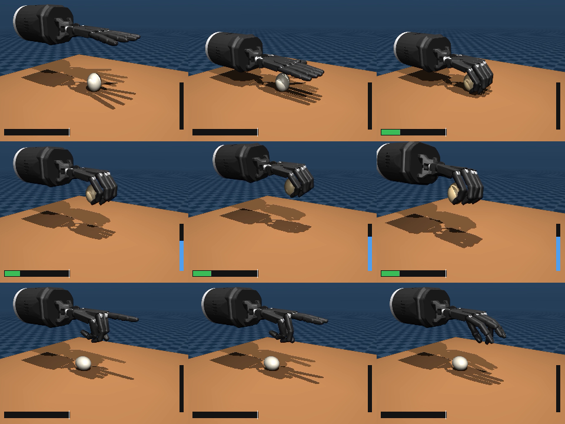
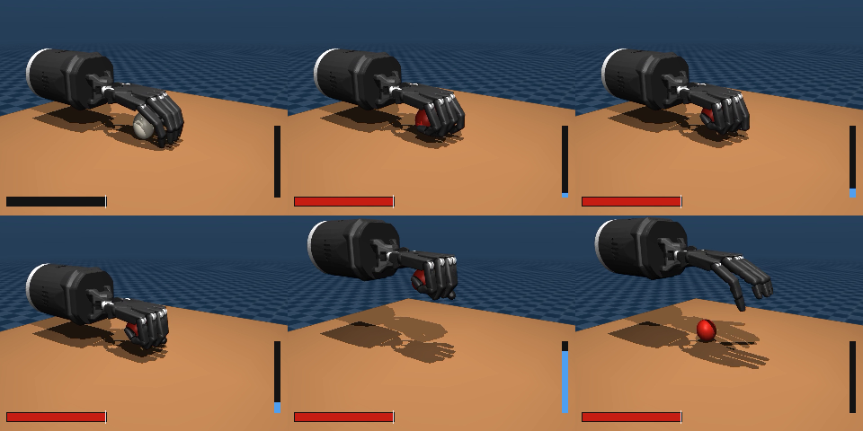

# rokoko-teleop: Egg Shell

Our entry for the Rokoko Robot Teleoperation Challenge (Junction 2026). The brief is in
[docs/junction/challenges/10-rokoko-the-robot-teleoperation-challenge.md](../docs/junction/challenges/10-rokoko-the-robot-teleoperation-challenge.md).

**The pitch:** you wear a Rokoko Smartglove and pick up an egg with a simulated Shadow Dexterous Hand.
Each attempt is saved as a training episode, and the simulator labels it: *lifted*, *not lifted* or *crushed*.
The robot hand never touches a real egg. You get a sorted set of dexterous demonstrations with grip-force data,
and nobody has to sort them by hand.




The force bar is at bottom left (red = cracked) and the lift bar is at the right.
Both frames are from `teleop demo`, which needs no hardware.

## Videos

All footage is MuJoCo simulation with a scripted operator: no glove was worn.

- Pitch (1:57.7): [video/out/egg-shell.mp4](video/out/egg-shell.mp4). Build notes: [video/BUILD-NOTES.md](video/BUILD-NOTES.md).
- Technical walkthrough (3:59.7): [video-extended/out/egg-shell-extended.mp4](video-extended/out/egg-shell-extended.mp4).

## Concept

Three candidates, judged against the brief. The weights are technical execution 35, originality 25,
usefulness 25 and human-controlled demo 15. Rokoko lists three interests: *precise manipulation of fragile
objects*, *collecting human demonstrations to train policies*, and creative uses.

| # | Idea | Strengths | Risks |
|---|---|---|---|
| 1 | **Egg Shell**: glove teleop of a dexterous hand in simulation. Each attempt becomes a labelled demonstration with grip force (lifted / crushed). | Covers two of Rokoko's interests (fragile objects, demonstration data). Runs with no shared robot. Grip force shows on screen. The same glove stream can drive the real Inspire hand. | Simulated force is a proxy, not a real egg. |
| 2 | Glove-to-robot sign language: the robot hand fingerspells what the operator signs, and can replay it for a deaf user. | Unexpected and easy to understand. | Needs high finger fidelity on real hardware to impress. Less useful as robot data. |
| 3 | Humanoid puppet show with the Smartsuit on the Unitree G1. | Strong stage effect. | Depends on the scarce G1, which is shared with another challenge, and on safety sign-off. Very little of it is our own work. |

**Choice: 1.** It is the only idea that we can demo reliably without the shared robots.
It addresses the two specific interests that Rokoko names (fragile objects, demonstrations for policy training).
The hook (the operator feels nothing, but the simulator *sees* the squeeze) shows the main problem of
teleoperation: there is no haptic feedback. Later, the same pipeline can drive the Inspire hand on the G1,
which turns "physical" into an add-on and not a dependency.

## Architecture

```
Smartglove ──> rkk-hand-solver ──RGMP v2 / TCP :12277──> RgmpSource ─┐
                     └──> rokoko-ros2-bridge ──/rkk_hand_bridge/hand/joints──> Ros2Source ─┤
recording.jsonl ──> ReplaySource ─────────────────────────────────────────────────────────┤
scripted operator (hand_model.forward) ──> SyntheticSource ───────────────────────────────┘
                                                        │ HandFrame: 26 OpenXR joint poses
                                                        ▼
  Teleop:  xr_base (Y-up) ─> Z-up ─> yaw calibration (fingers forward = +X)
           extract_angles ─> 21 canonical angles ─> neutral calibration ─> one-euro filter
              ├─> ShadowRetargeter ─> 20 Shadow actuator targets ──┐
              ├─> inspire_command ─> 6 Inspire values 0..1000      │ (for the real hand, not yet sent)
              └─> wrist pose ─> WristMapper ─> mocap target ───────┤
                                                                   ▼
  TeleopSim (MuJoCo): floating Shadow hand (Menagerie), welded to a mocap target, table, egg
                      with a crack threshold ─> EggState (force, lift, cracked)
                                                                   ▼
  EpisodeBuffer ─> datasets/<name>/episode_NNNN.npz + episodes.jsonl (automatic label)
  runner: headless (sim clock, MP4 with HUD) or live (wall clock, MuJoCo viewer, keys C/R)
```

What the gloves send, based on the code of [Rokoko/rokoko-ros2-bridge](https://github.com/Rokoko/rokoko-ros2-bridge):

- `rkk-hand-solver --emit-openxr` (Rokoko Device SDK 0.10 or later) serves **RGMP v2** on TCP 12277.
  Each message is a u32 type and a u32 length, followed by the payload. Type 1 is a JSON definition
  (`device_type: solved_hand`, with a `joints_openxr` group of 26 streams). Type 2 is binary data:
  `<IIQ` device_id, group_id, timestamp_us, then 26 × `<7f` (x y z qx qy qz qw) in `xr_base`, which is **Y-up**.
  Type 3 is a disconnect.
- The ROS 2 bridge republishes the same 26 poses as `rkk_hand_msgs/HandJoints` in Z-up (REP-103).
  It also applies a yaw that its `~/calibrate` service sets.
- Joints are in `XrHandJointEXT` order (palm, wrist, 4 thumb joints, 5 joints for each finger).
  The bone frames follow OpenXR: -Z points along the bone and +Y points out of the back of the hand.

`src/rokoko_teleop/rgmp.py` implements this format again, for both decoding and encoding. This lets us read
the solver directly (no ROS install on the laptop). It also lets `teleop fake-solver` act as the solver,
for our client and for Rokoko's own bridge.

### Retargeting

- **Human angles** (`retarget/human.py`): each angle comes from the rotation of a bone relative to its parent.
  For example, MCP = proximal relative to metacarpal, split into abduction and then flexion. The angles
  therefore do not change with the hand position, the heading or the uncalibrated yaw. The thumb CMC and
  the little-finger cupping are measured against an anatomical rest pose. A one-sample *neutral calibration*
  (a flat hand) removes the offset of each person. The extraction is the exact inverse of the parametric
  hand in `hand_model.py`, and the tests check this round trip.
- **Shadow** (`retarget/shadow.py`): mostly one to one (MCP flexion and abduction, PIP+DIP onto the coupled J0
  tendon, plus little-finger cupping). The thumb gains were tuned in MuJoCo so that the canonical pinch closes
  thumb and index together. The abduction signs are checked against the model.
- **Inspire** (`retarget/inspire.py`): curl per finger, mapped to 0..1000 (1000 = open) for little, ring,
  middle, index, thumb bend and thumb rotation. This is for the Inspire hand on the G1 and the Aalto
  integration. It is computed and recorded for every frame, but nothing sends it yet.
- **Wrist**: the OpenXR wrist frame is matched to the Shadow palm frame by a rotation that the code reads off
  the model (it is not typed in by hand). `absolute` mode is for synthetic data or a Coil Pro origin at the
  table. `relative` mode maps the hand position at calibration to the workspace centre (scale with `--wrist-scale`).

## Run it

You need Python 3.11 or later and [uv](https://docs.astral.sh/uv/).

```sh
cd rokoko-teleop
uv sync
scripts/fetch_menagerie.sh                 # Shadow hand model from MuJoCo Menagerie -> third_party/ (git-ignored)
scripts/glrun uv run pytest -q             # 57 tests: maths, wire format, TCP path, MuJoCo checks, Nemotron review (mocked)
```

To render video headless on Linux, put `scripts/glrun` in front of the command. It sets `MUJOCO_GL=egl`.
On NixOS it also gets Mesa from the system's own nixpkgs revision.

### With no hardware (replay and synthetic data)

```sh
scripts/glrun uv run teleop demo --scripts egg crush drop miss   # out/demo-<script>.mp4 + 4 labelled episodes in datasets/demo/
uv run teleop replay --dataset datasets/demo              # play the saved episodes again in the MuJoCo viewer (needs a display)
scripts/glrun uv run teleop replay --headless --video out/replay.mp4   # the same, rendered to MP4; exits 1 if a label does not reproduce
uv run teleop synth --out recordings/egg.jsonl --xr-base  # the scripted operator written as a raw glove recording
scripts/glrun uv run teleop run --source replay --file recordings/egg.jsonl --headless --video out/replay.mp4

# The full network path, with no gloves: a fake solver on :12277 and the live client.
uv run teleop fake-solver &                                # serves RGMP v2 like rkk-hand-solver
scripts/glrun uv run teleop run --source rgmp --headless --calibrate --seconds 13 --video out/live.mp4 --dataset datasets/live
```

### Second opinion on every label: NVIDIA Nemotron 3.5 Super VL

The simulator labels come from thresholds, and thresholds miss things: an egg that is lifted and then
dropped from 10 cm still counts as *lifted*. `teleop review` asks Nemotron 3.5 Super VL
(`nvidia/nemotron-3.5-super-vl-120b-a12b`, NVIDIA Build API) to label each saved episode again from
what it can see. It runs after the episodes are saved, never in the control loop.

- Evidence: `run_headless` renders camera frames at 4 Hz while it records, and saves the ones nearest to first
  contact, peak force, highest lift and the end as `episode_NNNN_<moment>.png`. The reviewer also sends a
  24-row force/lift timeline and facts (peak force, highest lift, descent speed, crack threshold) from the `.npz`.
  Live viewer episodes have no frames, so their review uses the log only.
- Output: strict JSON with the outcome (`lifted`, `dropped`, `not_lifted`, `crushed`), a confidence, a reason and
  evidence items that cite `frame:<name>` or `log` with a time.
- Quality steps: schema validation with one repair request; a grounding check (the peak force and the lift that the
  model states must match the log, and "crushed" needs a red egg or a force over the threshold), with one
  self-check request that shows the model the logged numbers; then a cross-check with the simulator label.
  A disagreement or an ungrounded answer is flagged for human review. The simulator label is never overwritten.
- Reliability: at most 3 requests per episode, a 60 s timeout, backoff on 429 and 5xx, a disk cache by request
  hash (`<dataset>/.nemotron_cache/`), and finished reviews are not repeated. With no key or with the API down,
  each episode shows `not_configured` or `unavailable` and the simulator label stands.

```sh
NVIDIA_API_KEY=nvapi-... uv run teleop nemotron-smoke            # one text and one image request
scripts/glrun uv run teleop demo --scripts egg crush drop miss --no-video  # episodes + keyframes in datasets/demo/
NVIDIA_API_KEY=nvapi-... uv run teleop review --dataset datasets/demo   # -> reviews.jsonl, review.md
```

On NixOS, uv's Python has no CA bundle: add `SSL_CERT_FILE=/etc/ssl/certs/ca-certificates.crt`.

**Result on the demo set (14 Nov 2026, [docs/demo-run/review.md](docs/demo-run/review.md)).** Four scripted
episodes: egg (lift and set down), crush, drop (lift, then open the hand in the air) and miss (grasp 5 cm too high).
Nemotron agrees with the simulator on 3 of 4. On the drop, the simulator says *lifted* (the egg rose 10.9 cm) and
Nemotron says *dropped* (confidence 0.98): "the grip force dropped to 0.0 N at t=6.25s while the egg was still at
3.4 cm height, followed by a rapid descent". The episode is flagged for a human. Four episodes is a smoke test, not
an accuracy figure.

The reasoning model can spend a small token budget on thinking and return no content. The review asks for up
to 4096 tokens, never caches an empty reply, and repairs it as an error.

### Weight-space programming: edit a policy by adding weights

The labels split the demonstrations into lifted and crushed sets. That makes task vectors possible: fine-tune a
behaviour-cloning policy on each set, subtract the base weights, and add or subtract the differences.
On a closed-loop policy and an egg that moves ±15 mm (5 seeds × 20 unseen egg positions), θ₀ + τ_lifted lifts
67 % of eggs where θ₀ lifts 27 %, and crushes 28 % where θ₀ crushes 62 %. Negating τ_crushed does *not* work
closed-loop: it breaks the reach. Method, all programs, a time-indexed baseline and limits:
[docs/weightspace/README.md](docs/weightspace/README.md).

### With real gloves at the venue

1. Get an SDK licence (Rokoko ID, then the form in the brief) and install Rokoko Device SDK 0.10 or later. Check it with `rokoko doctor`.
2. Start the solver: `rkk-hand-solver --emit-openxr --driver-arg=-ef --driver-arg=1024`. For gloves on Wi-Fi, see `hardware/README.md`.
3. Check that the stream works and record a sample. It replays later with no gloves:
   `uv run teleop record-glove --out recordings/venue-01.jsonl --seconds 30`
4. Teleoperate with the MuJoCo viewer window (needs a display):
   `uv run teleop run --source rgmp --dataset datasets/venue`
   - For the first 5 s, hold a **flat hand, level, fingers pointing forward**. This calibrates the yaw, the finger zero and the wrist anchor. Press **C** to calibrate again.
   - Press **R** to save the current episode (with its label) and reset the egg.
   - If the hand moves too much or too little, use `--wrist-scale 0.7`.
5. Through ROS 2 instead (the container in `hardware/rokoko/`): start the bridge, call its `~/calibrate`, then
   `uv run teleop run --source ros2`. This must run in a shell where ROS 2 is sourced, because `rclpy` does not install from PyPI.

## What is verified, and what needs hardware

Verified here, on a laptop with no gloves:

- The wire format matches the byte layout and the definition JSON in Rokoko's bridge code and tests.
  Fake solver → TCP → `RgmpSource` → angles come back within 1e-4 rad.
- The angle extraction inverts the hand model exactly, for both hands, any wrist pose, the Y-up/Z-up
  conversion and float32 on the wire (200 random poses in the tests).
- The Menagerie Shadow hand: the control ranges, the abduction signs and the palm frame match, and the pinch closes thumb and index.
- The scripted operator lifts the egg about 11 cm with a peak force of about 3.8 N. The squeeze script crushes it (about 20 N).
  The episodes save as `.npz` with labels in `episodes.jsonl`.
- The live RGMP client in real time against the fake solver: it calibrates, lifts the egg and records a labelled episode.
- Replay: each saved episode, driven again from its recorded actuator and wrist targets, gives the same label,
  lift and peak force (4 of 4 on the demo set).

Needs hardware or a display:

- Real Smartglove data. Unknowns: the real thumb CMC offsets, the noise level, whether the solver's
  metacarpal orientations look like our model, and what wrist position the gloves report without a Coil Pro.
  The neutral calibration and the relative wrist mode are there to absorb these.
- The `--source ros2` path. It is written against the bridge's message definition but not run, because ROS 2 is not installed here.
- The interactive viewer (`run_live`, `teleop replay` without `--headless`). It is written, but this machine has
  no display. Under Xvfb with Mesa the GLFW window opened but drew only black frames, so the demo video uses the
  headless renderer (the same scene and camera, with the force/lift HUD).
- The Inspire commands on a real Inspire hand: direction and range are not checked yet.
- The crack threshold (8 N of summed hand contact force) is a simulation proxy, set between the gentle grasp
  and the squeeze. It is not a measured property of an egg.

## Layout

```
src/rokoko_teleop/
  xrhand.py        OpenXR 26-joint skeleton, HandFrame, Y-up -> Z-up, yaw calibration
  rgmp.py          RGMP v2 decode + encode
  hand_model.py    canonical HandAngles, parametric hand (forward kinematics), named poses
  retarget/        human.py (angles, calibration, filter), shadow.py, inspire.py
  sources.py       RgmpSource, Ros2Source, ReplaySource, SyntheticSource, GloveRecorder
  teleop.py        pipeline: frame -> Command
  sim.py           MuJoCo scene: floating Shadow hand + table + egg, force/crack
  recorder.py      episodes + automatic labels
  runner.py        headless (video) and live (viewer) loops
  fake_solver.py   RGMP server: scripted operator or a recording
  synth.py         scripted operator (egg, crush, drop, miss)
  nemotron.py      NVIDIA Nemotron client (retries, timeout, cache)
  review.py        Nemotron 3.5 Super VL episode review, grounding check, cross-check
  weightspace.py   task vectors on policies trained from the labelled episodes
  cli.py           `teleop` command
tests/             test_retarget.py, test_rgmp.py, test_sim.py, test_review.py (HTTP mocked)
```

## Next steps

1. At the venue: record 30 s of real glove data (`record-glove`) on day one. Tune the thumb gains and the
   wrist scale on that recording, then rehearse the live demo.
2. Export the episodes to LeRobot format and train a small behaviour-cloning policy on "lifted" episodes only.
   Show that it beats a policy trained on all episodes. This proves that the labels have value.
3. Send `inspire_command` to the real Inspire hand (through the Aalto integration), so that one glove drives
   the simulation and the real robot hand side by side.
4. Use the haptics gap in the pitch: show grip force to the operator live (colour or sound), and measure how much it lowers the crush rate.
