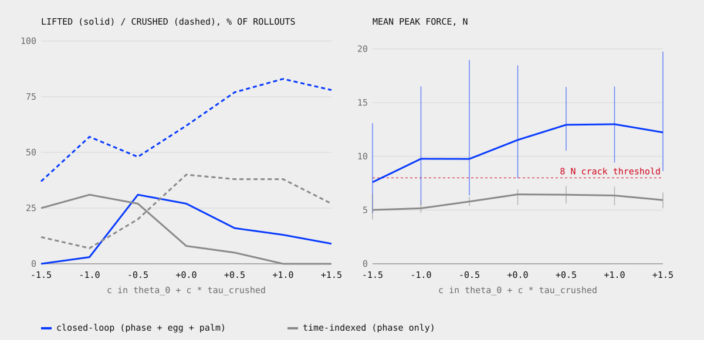

# Weight-space programming on Egg Shell demonstrations

## v2: a closed-loop policy, an egg that moves (latest, 15 Nov 2026 04:00 UTC)

**Setup** (`teleop weightspace gen --obs state --egg-range 0.015 --dart 0.006 --n 480`):
- 480 scripted-operator demonstrations (glove input is simulated). The egg starts at a random spot within ±15 mm,
  and the operator aims at it with up to 3 mm error.
- DART: during the approach only, smooth noise (σ 6 mm) moves the *executed* wrist off course while the clean
  action is recorded, so the policy sees states it must correct. The noise fades out before the hand closes.
- The simulator labels the demonstrations: 153 lifted, 255 crushed, 72 not lifted.
- The closed-loop policy reads the phase, the egg position, the palm position and their difference.
- The time-indexed baseline is trained on the same demonstrations and reads the phase only.
- 5 training seeds per policy. Each program runs on 20 egg positions that no demonstration used
  (100 rollouts per program).



**Results** (full tables: [results_v2.md](results_v2.md), raw: `results_v2.json`):

| Program (closed-loop) | Lifted | Crushed | Not lifted | Mean peak force |
|---|---|---|---|---|
| θ₀ (all demos) | 27/100 | 62/100 | 11/100 | 11.5 N |
| **θ₀ + τ_lifted** | **67/100** | **28/100** | 5/100 | 7.9 N |
| θ₀ + τ_crushed | 13/100 | 83/100 | 4/100 | 13.0 N |
| θ₀ − τ_crushed | 3/100 | 57/100 | 40/100 | 9.8 N |
| θ₀ + 2·τ_lifted | 6/100 | 73/100 | 21/100 | 15.5 N |

**What this shows.**
- **Adding the "lifted" task vector raises the success rate from 27 % to 67 %, and cuts crushes from 62 % to
  28 %**, on egg positions the policy never saw. No gradient step happens at program time.
- Adding the "crushed" vector goes the other way: crushes rise 62 % → 77 % → 83 % for c = 0, 0.5, 1.
- **Negation does not work closed-loop.** θ₀ − τ_crushed lifts 3 % and misses the egg 40 % of the time. The
  crushed fine-tune changed more than the grip, so subtracting it also breaks the reach. (With a fixed egg, in v1
  below, negation did work.)
- **The arithmetic is only roughly linear near a = 1.** θ₀ + 2·τ_lifted crushes 73 %.
- The time-indexed baseline cannot find an egg that moves: even its base policy misses 52 % of the time, and its
  best program lifts 31 %. So the state input matters, and the task vectors work on a policy that sees.
- The seeds vary a lot (for example, the base policy's mean peak force runs from 8.0 to 18.5 N across seeds), so
  each row is pooled over 5 seeds.

**Limits.** Scripted demonstrations, not a human in a glove. The policy sees the egg and palm positions from the
simulator, not from a camera. 8 N is a simulation threshold.

**Reproduce** (about 10 minutes on a 24-core laptop):

```sh
scripts/glrun uv run teleop weightspace gen --dir datasets/ws-state --n 480 --obs state --egg-range 0.015 --dart 0.006 --workers 24
# then for each seed s in 0..4 (copy demos.npz and setup.json into datasets/ws-state/seed$s):
scripts/glrun uv run teleop weightspace train --dir datasets/ws-state/seed$s --seed $s
scripts/glrun uv run teleop weightspace eval  --dir datasets/ws-state/seed$s --n-eval 20
uv run python scripts/ws_aggregate.py datasets/ws-state datasets/ws-phase --out docs/weightspace
```

## v1: a time-indexed policy, a fixed egg

**Question.** Egg Shell labels every teleoperated attempt as *lifted*, *crushed* or *not lifted*. Can those
labels be used to *program* a robot policy by arithmetic on its weights, with no new training at program time?

**Method** (`src/rokoko_teleop/weightspace.py`, `teleop weightspace all`).

1. Demonstrations: 120 scripted-operator episodes (glove input is simulated). The operator closes the hand on
   the egg, then squeezes by a random grip strength g in [0, 1], lifts, holds and sets it down, with ±3 mm
   position jitter and finger tremor. The simulator labels them: 36 lifted, 69 crushed, 15 not lifted
   (`demos.json`). In a probe, g ≤ 0.4 lifted the egg (peak 3.4 to 7.1 N) and g ≥ 0.5 crushed it (8.7 to 20 N).
2. Policies: a NumPy MLP (2 × 128 tanh) maps the episode phase to the 20 Shadow actuator targets and the wrist
   position. Behaviour cloning on all demonstrations gives θ₀. Fine-tuning θ₀ on the lifted demonstrations
   only gives θ_lifted, and on the crushed demonstrations only gives θ_crushed.
3. Task vectors: τ_L = θ_lifted − θ₀ and τ_C = θ_crushed − θ₀. Their cosine is −0.42 to −0.50 (3 seeds): the
   "gentle" direction and the "squeeze" direction point roughly opposite ways.
4. Programs: θ = θ₀ + a·τ_L + c·τ_C, run closed-loop in the MuJoCo sim. 5 rollouts each (the egg at the centre
   and moved 4 mm in x and y), for 3 training seeds: 15 rollouts per program.

**Results** (3 seeds × 5 rollouts; crack threshold 8 N, a simulation proxy):

| Program | a | c | Lifted | Crushed | Not lifted | Mean peak force (N), per seed | Mean peak force (N) |
|---|---|---|---|---|---|---|---|
| theta_0 (all demos) | +0.0 | +0.0 | 0/15 | 12/15 | 3/15 | 8.25 / 7.15 / 9.72 | 8.37 |
| theta_0 + tau_lifted | +1.0 | +0.0 | 12/15 | 0/15 | 3/15 | 3.67 / 5.24 / 4.38 | 4.43 |
| theta_0 + tau_crushed | +0.0 | +1.0 | 0/15 | 13/15 | 2/15 | 11.84 / 9.94 / 10.37 | 10.72 |
| theta_0 - tau_crushed | +0.0 | -1.0 | 10/15 | 4/15 | 1/15 | 7.00 / 6.48 / 8.46 | 7.31 |
| theta_0 + tau_lifted - tau_crushed | +1.0 | -1.0 | 12/15 | 1/15 | 2/15 | 6.55 / 3.03 / 4.68 | 4.75 |
| theta_0 + 2 tau_lifted | +2.0 | +0.0 | 5/15 | 1/15 | 9/15 | 7.57 / 3.28 / 3.44 | 4.76 |
| dial c=-1.5 | +0.0 | -1.5 | 11/15 | 3/15 | 1/15 | 7.05 / 6.00 / 8.03 | 7.03 |
| dial c=-1.0 | +0.0 | -1.0 | 10/15 | 4/15 | 1/15 | 7.00 / 6.48 / 8.46 | 7.31 |
| dial c=-0.5 | +0.0 | -0.5 | 4/15 | 10/15 | 1/15 | 11.09 / 7.29 / 8.21 | 8.86 |
| dial c=+0.0 | +0.0 | +0.0 | 0/15 | 12/15 | 3/15 | 8.25 / 7.15 / 9.72 | 8.37 |
| dial c=+0.5 | +0.0 | +0.5 | 0/15 | 13/15 | 2/15 | 10.90 / 7.40 / 10.86 | 9.72 |
| dial c=+1.0 | +0.0 | +1.0 | 0/15 | 13/15 | 2/15 | 11.84 / 9.94 / 10.37 | 10.72 |
| dial c=+1.5 | +0.0 | +1.5 | 0/15 | 13/15 | 2/15 | 12.96 / 11.39 / 11.75 | 12.03 |

**What this shows.**
- Adding the "lifted" task vector turns a policy that crushes 12 of 15 eggs into one that crushes 0 of 15 and lifts
  12 of 15, and halves the peak force (8.4 N to 4.4 N). No gradient step happens at program time.
- Adding the "crushed" vector raises the force (10.7 N) and crushes 13 of 15.
- The c dial is a grip-force knob in weight space. From c = −1.5 to +1.5, lifts go 11, 10, 4, 0, 0, 0, 0 of 15.
  The mean peak force rises from 7.0 N to 12.0 N, with one exception: c = −0.5 is higher than c = 0
  (8.86 against 8.37 N).
- Negation alone (θ₀ − τ_C) is less reliable than adding τ_L: 10 of 15 lifted, and on seed 2 it crushed 4 of 5.
- Too much is too much: θ₀ + 2·τ_L grips too weakly, and 9 of 15 eggs are not lifted. The dial has a failure at both ends.

**Limits.**
- The policy input is the episode phase only, so it is a time-indexed (open-loop) policy. A first version also
  read the hand joints and the egg position. With 120 demonstrations that closed-loop policy drifted and lifted
  0 of 5 eggs in every program, so we removed the state input. The task vectors edit *how hard the hand
  squeezes*, not where it goes.
- The demonstrations come from the scripted operator, not a human in a glove.
- The 5 rollouts per seed differ only in a 4 mm egg offset, so most of the spread comes from the 3 training seeds.
- 8 N is a simulation threshold, not a measured property of an egg.

**Reproduce** (about 5 minutes on a laptop CPU):

```sh
scripts/glrun uv run teleop weightspace all                    # seed 0 -> datasets/weightspace/results.md
scripts/glrun uv run teleop weightspace train --seed 1 && scripts/glrun uv run teleop weightspace eval
```

Per-seed results: `results_seed0.json`, `results_seed1.json`, `results_seed2.json`.
